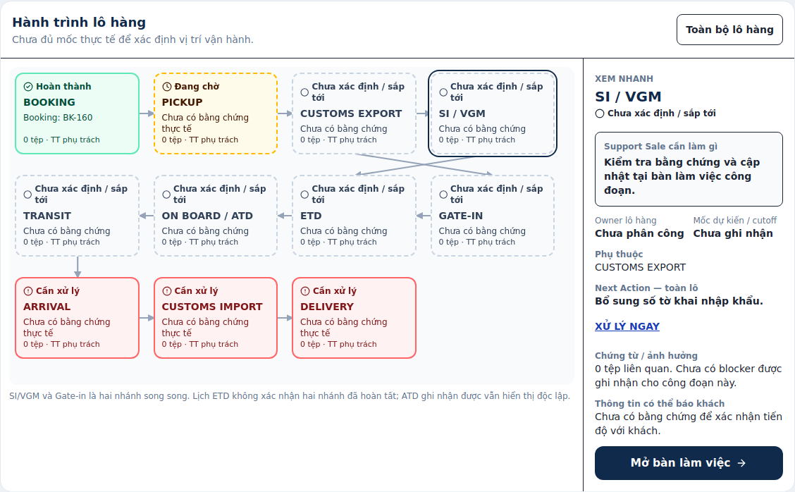
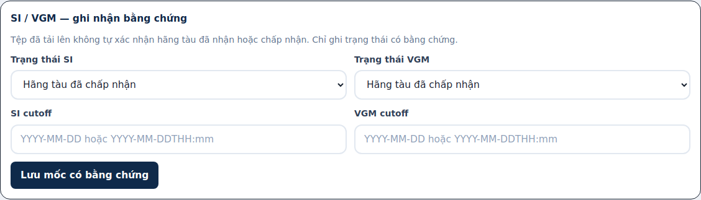
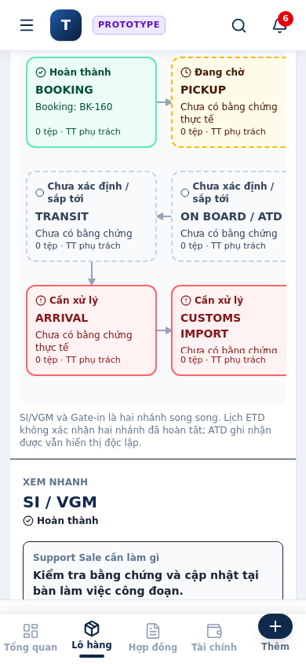
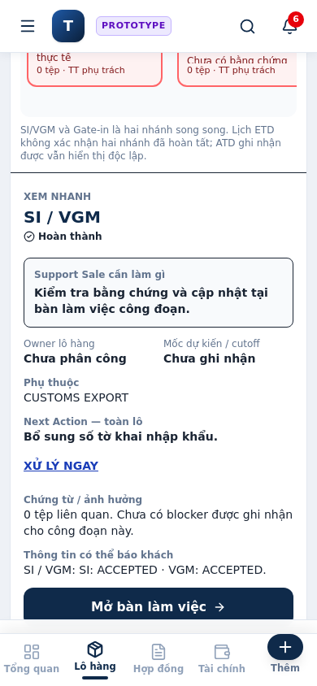

# Issue #160 implementation and review receipt

Base: `aaa3136ca354ac3c7671ea04e493ed6818ec688a`; freshly rechecked before publication.
Reference: `ct/visual-shipment-workspace-reference`, including refreshed portable
Supreme Law capsule, root AGENTS and frontend capability instructions.
Full issue and its handoff comment were read before implementation.

```text
P2P_LAW_SOURCE=LOCAL_PORTABLE (fresh reference handoff; NOT stale main capsule)
LAW_CHECK=PASS
SOURCE_SHA256=71cf783b192ac5761c5ddc0211b9cefe71cc70dd7d1abd41f5d28f1ce256858f
EXPERIENCE_CHECK=USE_ACTIVE_EXPERIENCE
EXPERIENCE_ID=shared-exp-b2611df4c9393f0017f07dcb
OE_GATE=Không bị over engineering chứ?
SIMPLER_PATH=YES MATERIAL_PROGRESS=YES NECESSITY=YES
CORE_BEFORE_SUPPORT=YES SMALLER_VERIFIABLE_SLICE=YES
OE_VERDICT=DO_IT
```

Accepted Library ZIPs were read and original SHA256 verified:
A `5d51462e263f25440bbd799bb4dcc04cbe4bb3440c51bdebe552663075c7e369`;
B `cfe20232afcd8c0872825658378d08d428f9f5525a6642fa629a457718673cac`.
No UX re-validation or new concept was undertaken.

## Bounded plan and resulting implementation

1. Inspect canonical facts/writers, then derive a pure visual index from the
   already-built execution profile. No stage persistence or new engine.
2. Persist only missing Sea submission/cutoff/gate-in facts in the existing
   shipment model and optional finance-line context. Use the existing atomic
   writer, RBAC, version check, audit and fresh readback.
3. Mount Journey Map / Quick Panel / Stage Workspace in ShipmentDetail;
   keep old tabs, anchors, primary routes and the export advisory gate.
4. Exercise canonical backend changes and production bundle; rebuild dist;
   publish for independent review without merging or deploying.

| Visual fact/context | Canonical authority |
| --- | --- |
| Stage-family relevance/ownership | Existing execution profile and confirmed service scope |
| Booking, pickup, ETD, ATD, ETA, ATA, containers | Existing operational compatibility projection / repeatable transport legs |
| Export declaration number | Existing root `china_export_decl_no`; registration never implies clearance |
| SI/VGM states, cutoffs, actual gate-in | Small explicit `data["1.2"].sea_export` block; bounded new event |
| Import / delivery | Existing `data["2.4"]` / `data["2.7"]` facts |
| Final Next Action | Existing `compose_primary_action`; critical/profile routes win over granular Sea requirements |
| Documents | Same canonical attachment IDs; contextual category filters; real upload/download/workflow unchanged |
| Stage costs | Same `data["3.4"].details`; optional `journey_stage`; historical lines remain unassigned |
| Owner | Existing dashboard owner, never `updated_by` |
| History | Honest whole-shipment timeline; no guessed historical stage assignments |

ATD establishes actual departure, not an on-board certificate. Past ETD/ETA,
configured scope, uploaded files and declaration registration do not establish
physical completion. Current position and unresolved earlier blockers remain
separate. SI/VGM and gate-in are parallel dependencies.

## Validation

- New Python suite: canonical writes/readback, scope/mode/load gating, UNKNOWN,
  parallel dependencies, action precedence, owner semantics, document IDs,
  Support/View permissions, finance metadata/non-duplication and request correlation.
- Expanded ten-suite backend run: **280 passed, 5 failed**. All five failures
  reproduced independently on unchanged pinned-main source:
  lightweight-create test expects full readback despite the current minimal
  create contract; two finance catalog expectations predate current metadata;
  two old contract UI tests reference removed `views.web_app` helpers.
- Existing execution-profile DOM suite also hits established baseline fixture
  drift: September lots are hidden by October's default period filter. The new
  acceptance explicitly selects all-time, without changing application defaults.
- New production-bundle DOM acceptance: PASS; 11 nodes, selection without
  writes, scoped navigation, pending/refusal, fresh readback, Viewer read-only,
  global escape and document/finance/history contexts.
- Chromium headless-shell runtime: PASS at **1440px and 390px**, real browser
  clicks through dispatcher → atomic writer → fresh full view-model;
  SI/VGM updates both node and panel. No page overflow, ≥44px workspace
  controls, zero page errors. Standard Chromium failed its startup syscall;
  headless shell provided actual rendering and screenshots.
- TypeScript check, Vite build and executable-process scan: PASS.
  Clean repeated build is byte-identical. No minified bundle edits.

Reproduce focused acceptance:

```sh
python -m pytest tests/test_visual_shipment_workspace.py -q
cd component
npm ci --ignore-scripts --no-audit --no-fund
npm run typecheck && npm run build && npm run scan
cd ..
python scripts/verify_visual_shipment_workspace.py --fixture /tmp/log160-dom.json
node tests/component/dom_acceptance_visual_shipment_workspace.mjs /tmp/log160-dom.json
# Optional external Playwright installation; no new application dependency:
node tests/component/browser_visual_shipment_workspace.mjs /tmp/log160-screenshots
```

The browser harness boots only the asserted mongomock transport on loopback;
it is verification tooling, not an application API.






## Review boundary

Independent review is pending. No merge, deployment or production mutation.
Payment write boundaries and finance arithmetic remain with their existing
canonical services. Whole-shipment functionality stays reachable. This PR
does not resolve unrelated baseline test drift.

`LEARNING_RECONCILIATION=NONE`: bounded task-specific decisions and environment
workarounds are captured here; no new reusable project-law rule is proposed.
