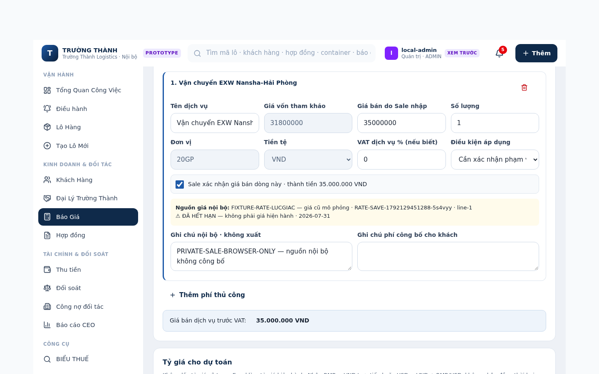
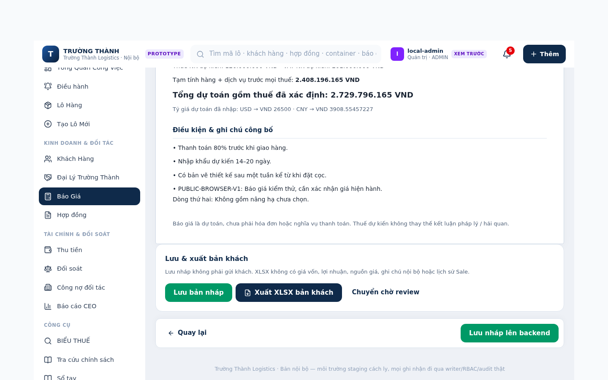
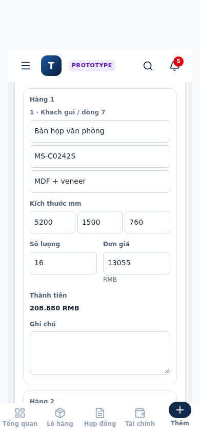

# Excel quote import V1 — evidence index

**2026-10-16 · actual repository app · isolated SANDBOX_STAGING only.**

[Implementation / scope / verification report](../../docs/LOGI_EXCEL_QUOTE_IMPORT_V1.md)

- [Final browser results (18 checks)](browser-results.json), [actual run log](browser-run.txt).
- [102 Python quotation/import regressions](python-quote-regression.txt) (31 new + 71 existing).
- [61 further core/cost/RBAC tests](python-core-rbac-regression.txt), separate process.
- [59 new-fixture/RBAC isolation tests](python-new-fixture-isolation.txt); overlaps the above, **not** an additional 59 unique tests.
- [Typecheck / tracked build / zero-executable-process scan](component-build.txt).
- [Cost matcher + 20 quick-parser checks + 7 legacy line-note DOM checks](component-focused-regression.txt).
- [Actual tool versions](environment.json), [verified product/source SHA256s](verified-source-sha256.json).
- [Known exploratory combined-Python failure](combined-python-isolation-failure.txt), [same failure on clean original baseline](baseline-python-isolation.txt).

The browser uses the real app, existing Cost Intelligence UI, existing C1 dispatcher, canonical writers and fresh readers. No route interception, injected view-model or fake API. Save/refresh/reopen/source-download/history/XLSX assertions ran against the app's **existing mongomock/GridFS staging transport**. These do **not** establish real MongoDB disk/replica/transaction durability or production readiness. Actual downloaded XLSX files were opened/asserted with openpyxl, not desktop Microsoft Excel.

The fixture is generated by `scripts/make_luc_giac_quote_fixture.py`, visibly marked SYNTHETIC. It is not the original Lục Giác workbook. Original/generated XLSX downloads remain in gitignored `.tmp/`; this folder contains only synthetic screenshots and text verification results.

## Desktop 1440 × 900

- [Step 1 entry / source review](desktop-step1-review-1440x900.png)
- [Editable goods](desktop-goods-1440x900.png)
- [Step 2 shipping/scope fields](desktop-step2-internal-1440x900.png)
- [Reference cost vs confirmed selling](desktop-fee-reference-vs-sell-1440x900.png)
- [Step 3 disclosure selection](desktop-step3-customer-1440x900.png)
- [Customer totals / selected disclosures / real export controls](desktop-customer-total-1440x900.png)





## Mobile 390 × 844

- [Step 1 header / source](mobile-step1-390x844.png)
- [Editable goods card](mobile-goods-390x844.png)
- [Cost/selling fields](mobile-fee-390x844.png)
- [Step 3 disclosure controls](mobile-step3-390x844.png)
- [Customer totals and public disclosures](mobile-customer-total-390x844.png)



These are screenshots of the actual integrated app, not image-generated designs. Desktop and mobile interaction had zero horizontal document/shell overflow; no JS pageerror events were observed. Donor rendering was unavailable (`net::ERR_CONNECTION_CLOSED`), so exact visual parity and Owner-device certification are not claimed.

## Baseline failures preserved honestly

### Legacy DOM/Journey return locator

Observed command: `node tests/component/dom_acceptance_quote_cost_workflow_ux_01.mjs`.
Quotation/cost steps through 8c passed. Step 9 failed at `click("Quay lại", "button")`:

```text
AssertionError [ERR_ASSERTION]: clickable "Quay lại" not found
  at click (.../dom_acceptance_quote_cost_workflow_ux_01.mjs:84:10)
  at .../dom_acceptance_quote_cost_workflow_ux_01.mjs:679:9
```

The exact same failure was observed using `5c6642a339ec53fe4cc300b15f665e2cd5384bca:component/dist/logi-shell.js`, loaded from a scratch copy. The current worktree bundle was never replaced. The baseline comparison used a copy of the unchanged test with only its `ROOT` and imported bundle path redirected to `.tmp/base-logi-shell.js`. Journey/shared shell were deliberately not changed to satisfy a stale test selector.

### Existing Python fixture state leak

Full original baseline was materialized read-only with `git archive 5c6642a | tar -x -C .tmp/base-checkout` (no branch switch). Running there:

```bash
/home/user/logistics-work-desk-arena/.venv/bin/python -m pytest -q \
  tests/test_phase_c1_business_contracts.py tests/test_logc15_auth_rbac.py
```

Result: **42 passed / 1 failed**, `test_unknown_role_falls_back_to_viewer`. Existing C1 fixture leaves an authenticated staging admin in Streamlit session state. The separately executed RBAC/core group passes. New Excel test fixture restores its previous user; new Excel + RBAC together pass 59 tests. This is not a claim that the all-in-one suite is clean.

No production DB was connected, no email was sent, no main merge/deploy occurred. Acceptance app port 9501 is stopped after testing.
