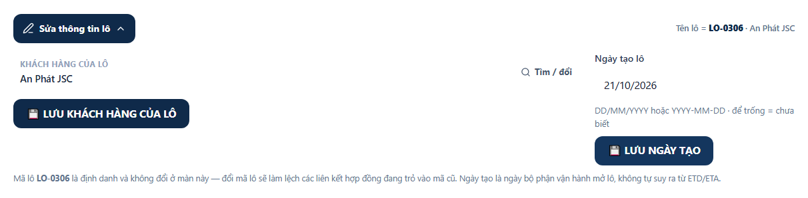
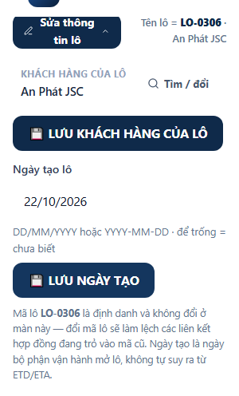
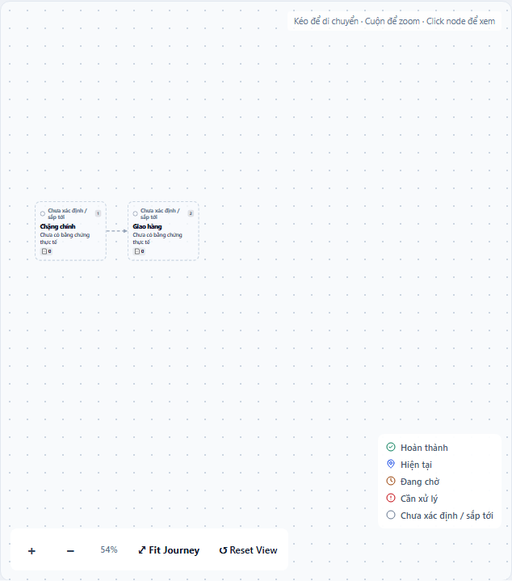
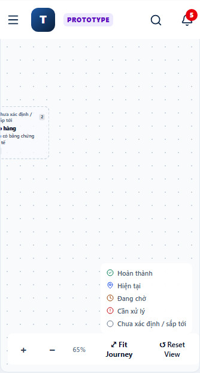

# PR #230 — React #310 QA

Verdict: PASS for the bounded isolated React #310 hotfix QA. This is not a clean full-suite, Cloud, release, merge, or deployment approval.

Repository: `7roger89-web/logistics-work-desk-arena`
Base: `5fd29f0bc2a893a319cf23e0f8f59c3842db704a`
Initial PR head: `b098ddbbc2ba607b488bff9ec90643e88387d47d`
Repair commit: `11bfeb189e83f55110fe564c5f4f86acc38321a0`

## Finding and bounded repair

The initial route guard prevents ShipmentDetail from changing its Hook count when a shipment disappears. It does not close the same invariant in ShipmentJourney: a return for an empty Journey preceded useRef/useEffect/useState. Delivering Journey nodes to the same mounted shipment reproduces the exact production React #310 on both the base and original PR head. Disappearing shipment alone reproduced #300 (fewer Hooks), not #310; these two observations are kept distinct.

The repair moves the empty-Journey return below all Hooks and uses an empty node list before the branch. No layout, permissions, finance or business-writer behavior changed. The regression now exercises empty -> ready -> empty Journey, shipment present -> absent -> present, and edit open/close. Its import uses pathToFileURL on Windows and waits for observable DOM state rather than assuming fixed render timing.

Invariant family: mounted shipment/Journey state transitions preserve React Hook order. Sibling surfaces checked: App route guard, ShipmentDetail, ShipmentJourney, shipped bundle, edit disclosure, customer picker, encoded shipment routes, G1 backend isolation and RBAC. Authority: the two Owner handoffs and repository AGENTS.md.

## Environment and isolation

Windows; Python 3.12; Node 25.2.1; Streamlit 1.60.0; headless Chromium via bundled Playwright. npm ci succeeded with a jsdom engine-range warning. Missing pypdf/Authlib were installed before the comparable full-suite runs.

The browser used 127.0.0.1:9501 and the real views.web_app.main entrypoint. A temporary wrapper initializes the existing SANDBOX_STAGING transport and seeds a disposable Support user into mongomock before the real password-login gate. No password gate was bypassed. Test credentials exist only in ignored .streamlit/secrets.toml and are never printed or committed. Authentication is required. No real Mongo URI, production instance or production database was used. Reload persistence means the same sandbox process; mongomock is not durable across server restarts.

The baseline is an archive of the exact base SHA. All 1,412 tracked files were checked byte-for-byte against that archive after test execution, with zero differences. The candidate is the isolated worktree D:/Logistics_PR230_QA. Owner checkout changes were not touched.

## Verification already observed

- npm ci: completed; no dependency files changed.
- npm run typecheck: PASS.
- npm run build: PASS; repeated final JS build byte-identical.
- py -3.12 scripts/scan_process.py component/dist: zero executable Node globals.
- Final committed JS SHA256: 93a0fd02996afd9157f8b939fa135e588c09bb5fda8201e7b15219d7ccd1c0b7.
- The generated JS equals the committed artifact exactly. The initial PR artifact differed from a Windows rebuild by module ordering/symbol allocation; the corrected artifact was rebuilt. CSS differed only in tiny platform-specific floating-point color conversions, so the existing CSS was preserved without a CSS commit.
- The regression fails with exact React #310 on base and initial head and passes on repair.
- Chromium desktop 1440x1000 and mobile 390x844: real Support password login, list/detail, open/close/reopen edit, change creation date, save, browser reload/re-login, stored-date readback; zero page errors or React/Hook console errors.
- Shipment header-edit DOM regression: seven checks PASS, including empty/unchanged input, backend confirmation, customer save, and refused writes.
- G1 customer-save DOM outcomes: PASS, including stale requestId, rejected write and readback mismatch.
- Encoded shipment identity DOM regression: six groups PASS.

The older sibling DOM tests were run from temporary copies with only Windows file-URL import, current-period navigation, current detail-workspace navigation and bounded wait adaptations. Those adapters are local evidence, not unrequested changes to older test files; the new React #310 regression runs directly from its committed path.

## G1/security comparison

Both baseline and candidate focused suites: 147 passed, four identical failures. The failures are:

1. tests/test_g1_pr228_regressions.py::test_react_header_customer_save_requires_matching_request_id_ok_and_readback — older test imports a Windows drive path as an ESM URL; the adapted DOM test passes.
2. tests/test_customer_portal_core_g1.py::test_customer_modules_have_no_browser_identity_or_url_id_path — source-shape assertion forbids any st.query_params, including the existing portal presentation selector. Runtime customer identity/isolation tests pass; that selector does not carry a customer ID.
3. tests/test_logc15_auth_rbac.py::TestRoleMatrix::test_unknown_role_falls_back_to_viewer — fails in combined-suite state on both refs; passes when run alone (1 passed). No permission source changed.
4. tests/test_shipment_slash_route_repair_01.py::TestBackendRouteProducers::test_primary_action_composes_encoded_segment_then_query_then_anchor — pre-existing profile anchor expects tab=nhap while code emits tab=van-tai. Encoded identity DOM checks pass.

No existing failing tests were weakened to obtain a green result. The detailed Journey Map was opened on both viewports and compared with the base runtime. Candidate and baseline screenshots are byte-identical: desktop SHA256 5437d25597a01e488ad90689dffb5ad5324a1ed0fd0fb71e3693780658d217b7; mobile SHA256 3a0e8a26fab0d4cc8541138658d829f68462227a365304caf3daf78007474de3. Mobile Fit Journey clips the seeded nodes at the edge on BOTH versions. This pre-existing visual limitation is DEFERRED_NOT_REQUIRED for the Hook-order repair; the screenshot comparison proves no map regression, not ideal mobile map usability.

Real Google OAuth and the Owner Cloud deployment were not exercised; no deployment is authorized by this QA.

## Existing dependency audit

npm audit reports three high findings in source-map-js, undici and vite; these are present in the unchanged dependency lock. They are recorded, not silently upgraded in a React Hook-order hotfix. This report is bounded hotfix QA, not a clean security audit or release approval.

## Reproduction commands

```powershell
# Both exact snapshots, with no real Mongo URI or secrets file:
py -3.12 -m pytest tests -q --continue-on-collection-errors --junitxml=<evidence-output.xml>
# Candidate component:
npm ci
npm run typecheck
npm run build
# Candidate root:
py -3.12 scripts/scan_process.py component/dist
node tests/component/dom_acceptance_react310_shipment_route.mjs
# The focused security set is recorded in the local g1-security.log / XML.
```

Full local evidence: D:/Logistics_PR230_evidence; browser runner and isolated wrapper: ignored .tmp/pr230. Final suite results and source-bound receipts are appended after completion.

## Learning reconciliation

LEARNING_RECONCILIATION=CANDIDATE: Windows EOL conversion is transport mismatch, not evidence of changed source. For a future identical case, first verify every authoritative Git blob against its bound hash and prove the checkout differs only by CRLF, then restore exact verified bytes in the isolated tree and re-hash. The three source/checkout hashes in preflight-receipt.json are the evidence; this candidate grants no policy override or source-integrity waiver.

## Final full-suite comparison

Both exact snapshots: **2063 passed, 63 failed, 23 skipped, 2 errors**, with 16 passing subtests. FAILED/ERROR node-ID sets are identical; new IDs = [] and resolved IDs = []. Exact full IDs (including the very large parameter IDs and duplicate failure/error counts) are in [failed-node-ids.json.gz](failed-node-ids.json.gz). Machine summary: [validation-summary.json](validation-summary.json).

The two runtime errors occur on the same oversized parametrized Excel test on Windows: PYTEST_CURRENT_TEST exceeds the Windows 32767-character environment-variable limit. The initial missing-pypdf collection errors were resolved before these comparable runs. Existing failures were retained and not repaired outside scope. An earlier baseline run had one additional transient GNT test failure; both final runs agree exactly and are the acceptance pair.

Runtime: baseline 799.457 seconds, candidate 819.511 seconds (JUnit suite times); both ran with the same installed dependencies and test environment. The tested source is commit 11bfeb189e83f55110fe564c5f4f86acc38321a0. The evidence-only successor changes no tested code. The final remote PR HEAD is recorded in the PR evidence comment and Owner return packet after push.

## Source and acceptance clearance

- App route guard / ShipmentDetail: existing absent/present guard retained and exercised by the production bundle regression.
- ShipmentJourney.tsx: all Hooks precede the empty/ready return; node transitions pass the same regression that reproduces #310 on both prior artifacts.
- Production bundle: typecheck/build/scan pass; repeated build and committed JS are byte-identical.
- Customer/permission/data boundaries: no implementation changed; focused tests and adapted UI regressions provide the scope-matched evidence described above. Four pre-existing focused failures remain explicitly classified.
- Worktree inspection covers committed-after-base, staged, unstaged and nonignored untracked files. No unexpected source delta exists. Only hotfix files and this scoped evidence directory are intended for the PR.
- QA services on port 9501 were stopped after browser work. Ports 8501 and 8510 were not operated.
- Residual unverified scope: real Google OAuth and Owner Cloud environment; neither is authorized or required for this isolated QA. Existing mobile map fit clipping and dependency audit findings are recorded above. These findings are not silently claimed fixed.

## Browser evidence

All data shown is synthetic staging data. Desktop is 1440x1000; mobile is 390x844.






Map byte-identity evidence: [map-baseline-comparison.json](map-baseline-comparison.json). Actor-own law/skill receipt: [preflight-receipt.json](preflight-receipt.json).

## Return packet

```text
LAW_CHECK=PASS
P2P_LAW_SOURCE=LOCAL_PORTABLE
EXPERIENCE_CHECK=USE_ACTIVE_EXPERIENCE; shared-exp-b2611df4c9393f0017f07dcb
SKILL_CONSUMPTION_RECEIPT=p2p-skill-consumption-receipt/1; preflight-receipt.json
SKILL_SOURCE_MATCH=3/3
SKILL_CHECKOUT_BYTE_MATCH=3/3
OE_VERDICT=DO_IT
BASELINE_FAILED_NODE_IDS=failed-node-ids.json.gz:baseline
CANDIDATE_FAILED_NODE_IDS=failed-node-ids.json.gz:candidate
NEW_FAILED_NODE_IDS=[]
REACT310_BASELINE_REPRO=YES; exact #310; initial PR head also reproduces
TYPECHECK=PASS
BUILD=PASS
SCAN=PASS; 0 executable Node globals
DIST_REPRODUCIBLE=PASS; final JS matches repeated build and committed artifact
JSDOM=PASS
CHROMIUM_DESKTOP=PASS; real sandbox Support login/save/reload
CHROMIUM_MOBILE=PASS; real sandbox Support login/save/reload
G1_SECURITY_REGRESSION=147 passed; 4 identical baseline failures; 0 new; isolated fallback-role test PASS
STAGING_DEPLOY=NO
PRODUCTION_WRITE=NONE
PR_MERGED=NO
QA_VERDICT=PASS
BLOCKERS=NONE within bounded isolated hotfix QA
NEXT_ACTION=Owner decides any later staging deployment; keep PR Draft
```

## Owner challenge summary

WHAT_WAS_DONE: reproduced and repaired a second Hook-order violation remaining in the original hotfix; verified real edit/save/reload and no new pytest failures.
WHY_THIS_PATH: a three-file incremental repair on the existing PR closes the demonstrated invariant.
ALTERNATIVES_CONSIDERED: retain only the original route guard; broadly refactor the Journey UI.
WHY_NOT_THE_ALTERNATIVES: the route guard still reproduces #310; a broad refactor adds unrelated risk.
EVIDENCE_THAT_SUPPORTS_THE_RESULT: exact prior-artifact #310 failures, passing final regression, matching full-suite failure sets, authenticated Chromium readback, source/bundle hashes and screenshots.
WHAT_COULD_STILL_BE_WRONG: Owner Cloud-specific behavior and real Google OAuth were not exercised; recorded baseline defects still exist.
WHAT_WOULD_FALSIFY_OR_REOPEN_THE_RESULT: reproduce a Hook error on the pinned repaired artifact, find a new failed/error node ID, or fail authenticated save/reload under the same sandbox conditions.
OVER_ENGINEERING_RISK_OR_NONE: no additional infrastructure, dependency upgrade or business refactor.
OWNER_ACTION_NOW: decide whether to authorize a later staging deployment; this run performs none.
