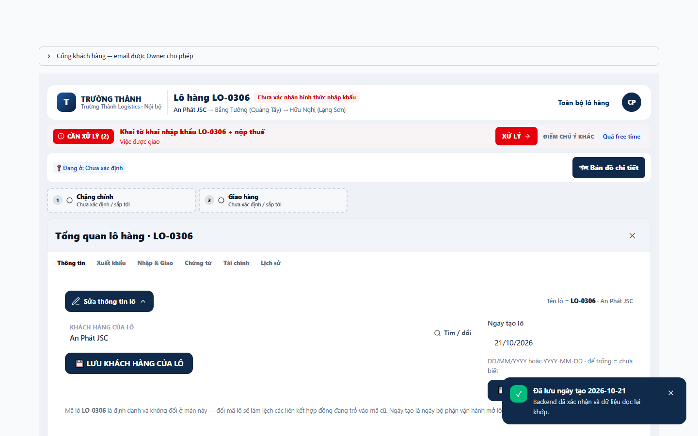
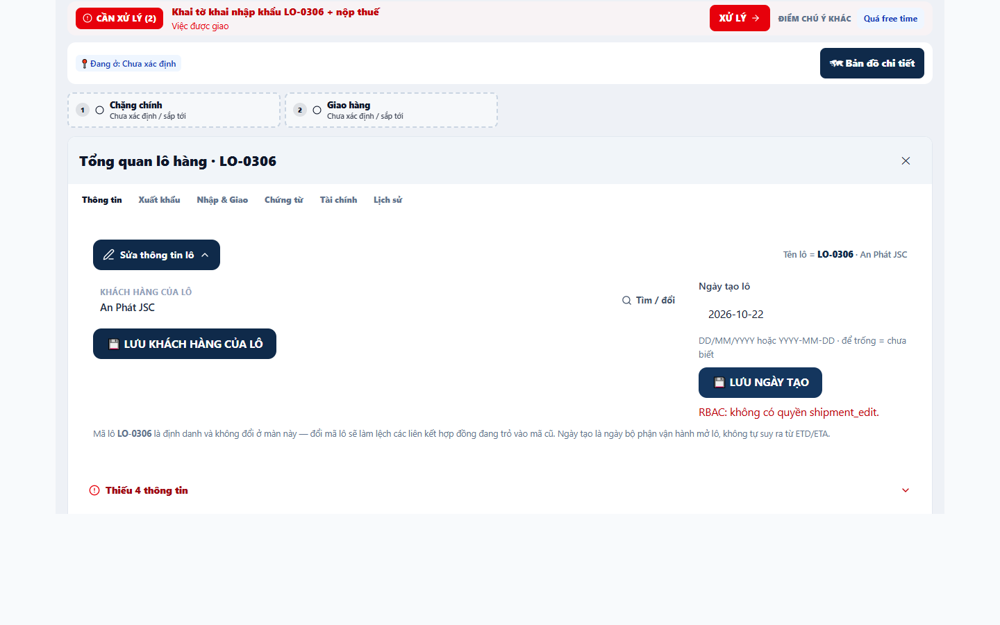

# PR #231 — FAST GATE evidence packet

Packet validation: **PASS**. Independent acceptance review: **PENDING**. Keep PR Draft; no merge or staging integration is authorized by this packet.

Authority: [FAST GATE request](https://github.com/7roger89-web/logistics-work-desk-arena/pull/231#issuecomment-6487530139). Packaging started from exact PR HEAD `3c310e9def14d76ae59d3b0bf895fe94770259f4`. Runtime/source evidence is bound to `9fbff3b86bc06be9ee6ad11f200ddfab500efb8a`; the intervening commit changes only the prior QA report. This follow-up adds evidence only: no source, test, dist, configuration or dependency changes, and no new test/browser/full-suite run.

## Reviewable artifacts

- [manifest.json](manifest.json): platform-neutral Git source hashes, original Windows checkout hashes, input/artifact hashes, exact browser command and provenance via the browser results, current actor's law/skill receipt and sanitization scope.
- [chromium-results.json](chromium-results.json): original browser command, exit **0**, console errors **[]**, save/readback/reload and viewer-denial assertion markers. Real Streamlit 1.60 / Python 3.12 / Chromium on loopback:9501, isolated mongomock `logistics_staging`, synthetic seed only. Browser version was not recorded; no version is invented here.
- [save-readback-viewer-denial.json](save-readback-viewer-denial.json): strict projection from original snapshots. Admin save request is `ok=true`, persisted canonical `data.0.0.created_at=2026-10-21`; viewer request attempts `2026-10-22`, returns correlated `ok=false` with RBAC error, and DB readback remains `2026-10-21`. Reload/relogin readback was asserted by the completed browser run. Raw shipment documents, contacts, addresses, tax IDs, financial details and audit identities are excluded.
- [failed-error-node-sets.json.gz](failed-error-node-sets.json.gz): exact before/after unique FAILED+ERROR parent node IDs plus summaries and the unstable docgen node. Gzip keeps the synthetic oversized workbook parameter small; no IDs were truncated. Inspect with standard `gzip`/`json`; this is data, not a new QA runner.

| Existing full run | Passed | Failed | Skipped | Errors | Unique FAILED/ERROR nodes |
|---|---:|---:|---:|---:|---:|
| Baseline `0090151` | 2061 | 78 | 23 | 2 | 70 |
| Repair `9fbff3b` | 2068 | 77 | 23 | 2 | 69 |

Added nodes: **[]**. Removed in the full run: `tests/test_gnt_and_docgen_reality_check.py::test_gnt_revision_comes_from_durable_docgen_metadata_after_session_clear`. It is **not claimed fixed**: already-completed isolated checks reverse the full-run outcomes (baseline passes, repair fails at `attachmentDuplicate is True`). Counts include subtest failures, so they differ from unique parent-node counts. No new skip or test weakening concealed a failure.

### Two original screenshots, synthetic data only

Saved date with backend-confirmation toast:

Viewer denial with inline RBAC error and no success toast. The input shows the rejected draft; the stored value remains the earlier accepted date in the JSON readback:

## Reuse React #310 evidence

Use [PR #230's existing QA result](https://github.com/7roger89-web/logistics-work-desk-arena/pull/230#issuecomment-6461832176), [report at exact evidence commit](https://github.com/7roger89-web/logistics-work-desk-arena/blob/e09ea1146eae38d80bc9857f2ad4b3cf6c9c70a3/reports/pr230-react310-qa/QA_REPORT.md), and [machine summary](https://github.com/7roger89-web/logistics-work-desk-arena/blob/e09ea1146eae38d80bc9857f2ad4b3cf6c9c70a3/reports/pr230-react310-qa/validation-summary.json). This packet does not duplicate the Hook-order campaign or re-certify Cloud/OAuth/production.

## Preflight and packet checks

The current actor reread target AGENTS.md, the portable law, selected scope-reality-check skill and ACTIVE experience before packaging. `LAW_CHECK=PASS`, `P2P_LAW_SOURCE=LOCAL_PORTABLE`, recorded source identity `11ce33bb9c514d32ad3aec3eb7d8b40f0d0290b1dbe79eaa15751ef34668bd4b`. `EXPERIENCE_CHECK=USE_ACTIVE_EXPERIENCE`, ID `shared-exp-b2611df4c9393f0017f07dcb`. The new source-bound skill receipt is in the manifest; it does not inherit the earlier executor receipt.

Không bị over engineering chứ? SIMPLER_PATH=YES, MATERIAL_PROGRESS=YES, NECESSITY=YES, CORE_BEFORE_SUPPORT=YES, SMALLER_VERIFIABLE_SLICE=YES. `OE_VERDICT=DO_IT`: reuse and publish only the already-completed acceptance slice.

Packet checks performed now: original image/readback/console hashes match the prior run's manifest; tested source blobs equal packaging-parent source blobs; JSON is field-allowlisted; node-ID set arithmetic matches the frozen full-run comparison; compressed node IDs pass sensitive-value pattern screening; both screenshots were visually inspected; artifact hashes are recorded. No credential files, auth cookies, raw stdout or `.tmp` wholesale were included. Current review checks the packet only, not a fresh application run.

Reviewer can verify artifact SHA-256 values, read the two outcomes and compare exact node sets, then inspect the existing source delta. No rerun is needed merely to establish this packet's availability. `READY_FOR_INDEPENDENT_REVIEW=YES`; acceptance remains the independent reviewer's decision. `LEARNING_RECONCILIATION=NONE` for this routine evidence publication.
